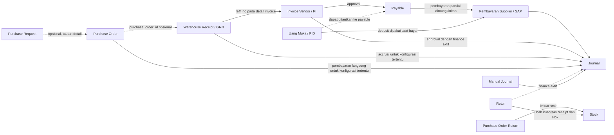

# Analisis Alur Transaksi dan Akuntansi

**Tanggal audit:** 3 November 2026  
**Status bukti:** VERIFIED / ASSUMED / UNKNOWN / NEEDS REVIEW

## Ringkasan alur

Diagram menunjukkan jalur yang ditemukan pada kode, bukan keharusan satu rangkaian untuk setiap transaksi. Garis putus-putus menandai hubungan opsional atau yang bukti relasinya tidak lengkap.

## Temuan per alur

| Pertanyaan | Temuan | Status | Bukti |
|---|---|---|---|
| Apakah PO wajib berasal dari PR? | Tidak pada jalur `PurchaseOrderController::store`; PR dapat ditautkan pada tingkat detail di jalur pembuatan dari PR. | VERIFIED | `app/Http/Controllers/Operational/PurchaseOrderController.php`; `app/Models/PurchaseOrder.php` |
| Apakah GRN dapat menerima sebagian kuantitas PO? | Struktur dan pembaruan kuantitas kumulatif mendukung penerimaan sebagian. Pemanggilan pemeriksaan batas PO yang ditemukan tampak dikomentari pada jalur yang ditelaah, sehingga penolakan kuantitas berlebih tidak terbukti secara menyeluruh. | VERIFIED untuk pencatatan parsial; UNKNOWN untuk enforcement maksimum | `app/Http/Controllers/Operational/ReceiptController.php`; `purchase_order_receipt_details` |
| Satu PO dapat mempunyai beberapa GRN? | Ya, penerimaan memperbarui kuantitas kumulatif PO dan tiap receipt menyimpan `purchase_order_id`. | VERIFIED secara implementasi | `ReceiptController.php`; model terkait receipt/PO |
| Satu GRN dapat mengacu ke berapa PO? | Jalur header menyimpan satu `purchase_order_id`; jadi paling banyak satu PO pada jalur ini. | VERIFIED | `ReceiptController.php`; schema header `warehouse_receipts` |
| PI dapat mengacu pada GRN? | Ya. Detail invoice mencari receipt menggunakan `reff_no` yang dicocokkan dengan `warehouse_receipts.code`; satu invoice dapat memuat detail yang menunjuk beberapa GRN. | VERIFIED | `app/Http/Controllers/Operational/InvoiceVendorController.php` (pencarian `reff_no` pada detail) |
| GRN yang sama boleh dipakai ulang pada PI lain? | Tidak ditemukan pemeriksaan duplikasi/reuse pada pencarian `reff_no`. Dampak dan aturan bisnisnya belum dapat dipastikan. | UNKNOWN / NEEDS REVIEW | `InvoiceVendorController.php`; pencarian kode receipt `reff_no` |
| PI dibuat langsung dari PO? | Bukti pada jalur yang diperiksa menunjukkan referensi GRN (`reff_no`); jalur PI langsung dari PO tidak terbukti. | UNKNOWN | `InvoiceVendorController.php` |
| PID diperhitungkan terhadap invoice? | Deposit digunakan pada alur pembayaran supplier; controller juga memiliki jalur mengaitkannya ke payable. Tidak cukup bukti bahwa PID otomatis dialokasikan ke PI saat pembuatan invoice. | VERIFIED untuk penggunaan dalam pembayaran; UNKNOWN untuk alokasi otomatis ke PI | controller uang muka dan pembayaran supplier |
| Pembayaran parsial disimpan? | Pembayaran membuat detail debit payable dan transaksi pembayaran; perhitungan sisa hutang membandingkan total debit dan kredit. | VERIFIED | `DebtPayableController.php`; model `Payable` |
| Bagaimana diskon dan pajak dihitung? | Nilai diskon/PPN disimpan/diproses dalam jalur invoice. Formula menyeluruh, basis pajak, urutan diskon-pajak, serta kebijakan pembulatan belum dapat ditetapkan dari bukti yang ditelaah. | NEEDS REVIEW | `InvoiceVendorController.php`; helper perhitungan terkait |
| Dampak retur? | Kedua jalur retur yang ditelaah mengubah stok/kuantitas receipt; jalur `returs` dapat membuat jurnal jika pengaturan finance berlaku. Efek terhadap payable tidak ditemukan secara langsung. | VERIFIED untuk stok/jurnal bersyarat; UNKNOWN untuk payable | controller retur; `stock_transactions`; `retur_details` |
| Kapan jurnal dibuat? | Jalur otomatis ditemukan pada approval invoice, kondisi tertentu saat receipt/PO, pembayaran, PID, dan retur; jurnal manual juga tersedia. Posting jurnal merupakan langkah status tersendiri. | VERIFIED | controller operasional dan `app/Http/Controllers/Finance/JournalController.php` |
| Apakah jurnal selalu seimbang? | Kode jurnal manual yang ditelaah mengisi total debit dan kredit dari input masing-masing. Pemeriksaan global yang memastikan debit = kredit tidak ditemukan pada jalur approve/post yang diperiksa. | UNKNOWN | `Finance/JournalController.php` |

## Interpretasi dan batas

- Rangkaian PR → PO → GRN → PI → Payable → Payment → Journal bukan satu-satunya jalur yang didukung. PO dapat berdiri tanpa PR, GRN memiliki pilihan PO, dan jurnal dapat dibuat manual.
- Hubungan berdasarkan nomor/kode dokumen perlu dibedakan dari foreign key deklaratif. Pencocokan `reff_no` ke kode receipt merupakan bukti perilaku aplikasi, bukan bukti bahwa semua laporan sumber mempunyai referensi yang unik.
- Status approval/posting tidak boleh direkonstruksi hanya dari keberadaan dokumen pada workbook. Laporan sumber tidak memuat seluruh status aplikasi.
- Konfirmasi bisnis diperlukan untuk pemakaian ulang GRN pada invoice, kebijakan kuantitas lebih, perlakuan retur terhadap hutang, formula pajak/diskon/pembulatan, dan kontrol debit-kredit.

## Sumber yang ditelaah

`PurchaseOrderController`, `ReceiptController`, `InvoiceVendorController`, controller uang muka dan pembayaran supplier, controller retur, model `Payable`, `Finance/JournalController`, model dan relasi terkait, serta schema target yang diringkas dalam `target-audit.md`. Audit source code statis; aplikasi tidak dijalankan karena kompatibilitas bootstrap Laravel 5.6 dengan runtime PHP 8.2 bermasalah.
