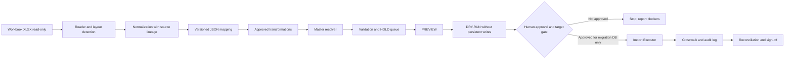

# Rancangan Struktur Proyek Importer

**Tanggal pembaruan:** 3 November 2026  
**Status:** **PROPOSED**; struktur konseptual aplikasi lokal terpisah, belum dibuat.

## Prinsip penempatan

Importer berada pada direktori/repository lokal tersendiri di luar repository Solog OLI. Ia tidak menjadi Laravel module atau source application change. Nama/lokasi final, bahasa/runtime, framework XLSX, penyimpanan crosswalk, UI/CLI, serta secret store adalah **NEEDS REVIEW** sebelum implementasi. Jangan menaruh workbook, kredensial, hasil sensitif atau artefak kerja pada repository publik.

## Struktur usulan

```text
solog-oli-importer/                 # proyek lokal terpisah; nama/lokasi belum diputuskan
├── README.md
├── config/
│   ├── importer.example.json        # tanpa secret; hanya contoh skema config
│   └── mappings/                   # JSON berversi, draft tidak importable
├── src/
│   ├── cli/                        # perintah inspect, preview, dry-run; import gated
│   ├── workbook_reader/            # XLSX, sheet, cell, merge, formula metadata
│   ├── layout_detector/            # header, detail, continuation, subtotal
│   ├── data_normalizer/            # nilai raw, normalized value, provenance
│   ├── mapping_engine/             # config → candidate target records
│   ├── transformation_engine/      # transform yang disetujui dan versioned
│   ├── master_resolver/            # lookup/crosswalk master, ambiguity handling
│   ├── validation_engine/          # schema/domain/FK/business validations
│   ├── preview/                    # planned changes dan exceptions
│   ├── dry_run/                    # tanpa persistent writes
│   ├── import_executor/            # disabled/gated target writer
│   ├── crosswalk_manager/          # source locator ↔ internal target ID
│   ├── import_logger/              # batch events dan outcome
│   └── reconciliation/             # counts, quantities, balances, journals
├── schemas/                        # JSON Schema config/crosswalk/report
├── tests/                           # fixtures sintetis; tidak memakai source asli tanpa izin
├── reports/                         # output lokal terpisah, gitignored, akses terbatas
├── state/                           # crosswalk/batch state, lokal terenkripsi bila perlu
└── .gitignore                       # workbook, secrets, state, logs dan generated reports
```

Struktur ini rekomendasi, bukan file/folder yang dibuat oleh Stage 4.1.

## Batas tanggung jawab modul

| Modul | Input | Output | Batas/kontrol |
|---|---|---|---|
| Workbook Reader | XLSX asli read-only | Workbook/sheet/cell model dengan koordinat, style, merge, formula metadata | Tidak menyimpan ke XLSX; membatasi file size/zip expansion. |
| Layout Detector | Cell model | Kandidat header/detail/subtotal/continuation dan confidence/evidence | Low confidence atau layout berubah → hold/manual review. |
| Data Normalizer | Kandidat rows + raw cells | Canonical values beserta raw value dan lineage | Tidak kehilangan cell address/raw representation; empty tidak otomatis null/default. |
| Mapping Engine | Canonical rows + JSON mapping berversi | Candidate target headers/details/relations | Mapping draft/UNKNOWN tidak boleh dieksekusi. |
| Transformation Engine | Candidate value + approved transform registry | Typed target candidates + transformation trace | Tidak menebak tax, rounding, status, unit atau default. |
| Master Resolver | Candidate natural reference + approved master/crosswalk snapshot | Matched/ambiguous/unmatched/hold | Exact name saja tidak cukup; tidak membuat master atau ID. |
| Validation Engine | Candidate target + target schema/domain snapshot | Error/warning/hold per field/record/relation | UNKNOWN rule bukan pass; FK wajib resolve. |
| Preview | Validated candidate set | Human-readable planned changes/counts/conflicts | Read-only; no database writes. |
| Dry Run | Same plan + isolated read-only/mock target model | Simulated outcomes, FK/idempotency/reconciliation report | Must prove no persistence; no importer DB writes. |
| Import Executor | Approved signed batch plan | Target records only in authorized migration DB | Disabled by default, isolated module, allowlisted DB, approval gate and batch controls. |
| Crosswalk Manager | Source identity, match evidence, target result | Versioned crosswalk and resolution state | Internal target IDs only after resolution; conflict stops batch. |
| Import Logger | Batch context/events | Audit log with counts, error codes and references | No credentials; limit sensitive payload. |
| Reconciliation | Source control totals + accepted target/simulated data | Variance and sign-off report | No silent tolerance; business-approved thresholds required. |

## Data flow



The diagram describes proposed flow only. Production requires a separate explicit authorization, backup verification and cutover controls.

## Artifact boundaries

- `config/mappings/`: mapping JSON draft/approved version; schema-valid, evidence-linked, no credentials.
- `state/`: crosswalk/batch state; local access restricted and backup/retention policy defined before real data.
- `reports/`: preview/errors/reconciliation; avoid raw workbook dumps and secrets; document retention/access.
- `tests/`: synthetic fixtures or authorized sanitized samples. Do not mutate source workbook.
- `import_executor/`: separate capability and permission boundary. PREVIEW/DRY-RUN must remain functional when executor is disabled or absent.

## Deployment and implementation order

Implement in this order after required approvals: (1) project/bootstrap/security boundaries; (2) schema contracts/config validator; (3) workbook reader/layout detection; (4) normalizer and locator; (5) mapping/transformation engines; (6) master resolver; (7) validation and hold reports; (8) preview; (9) dry-run/reconciliation; (10) crosswalk/logger persistence in isolated test environment; (11) staging import executor with idempotency and rollback tests; (12) separate production readiness review. Current Stage 4.1 authorizes documentation only; no project structure or code has been created.
